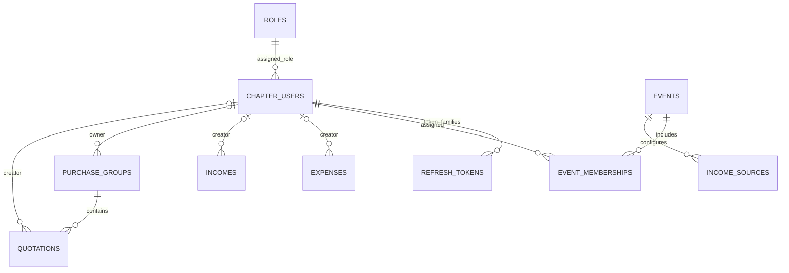

# JWT authentication and authorization

## Scope and migration from the in-progress session implementation

This is the authoritative backend authentication contract. The backend uses Java 21,
Spring Boot 4.1.2, Spring Security 7.1.2 (confirm with the dependency tree), Hibernate
from the existing JPA starter, MySQL and Flyway. Packages remain technical layers.
React is connected to this JWT API using JSON login, in-memory bearer tokens,
cookie refresh, and role-aware requests. The existing screen styling is preserved.

No SRS was found in the repository. The permission model below combines the written
JWT requirements with the user's subsequent clarification about the two team leads.
Volunteer-owned procurement requests, file attachments and transaction receipts do
not exist yet. Their permissions are defined here; their APIs are denied until
implemented. Existing quotation entry remains available with ownership enforcement.

## Permission matrix

| Action | Committee member | Finance Team Lead | Logistics Team Lead | Generic volunteer |
| --- | --- | --- | --- | --- |
| List/read events | All | Assigned events, metadata | Assigned events, metadata | Assigned events, metadata |
| Create events | Yes | No | No | No |
| Manage/read full budgets | Yes | No | No | No |
| Add/edit expenses and income | All records | Own records in assigned events | No | No |
| List expenses/income | All | Own records only in assigned events | No | No |
| Configure income categories/sources | Yes | No; use configured categories | No | No |
| Create purchase groups / assign owners | Yes | No | No | No |
| View purchase groups/quotations | All | No | Owned groups and own quotations in assigned events | No |
| Submit/edit/remove quotations | All | No | Own unselected quotations in owned groups, assigned events | No |
| Choose/clear preferred quotation | Yes | No | No | No |
| Manage event assignments | Yes | No | No | No |
| Manage accounts/assign security roles | Only with ACCOUNT_ADMIN privilege | No | No | No |
| View profile/change password | Own | Own | Own | Own |
| PDF quotation/bill uploads | Future feature | Future feature | Future: own permitted purchases only | No |
| Treasurer transaction receipt | Future feature | Future scoped access | Future: receipt linked to own permitted purchase/expense only | No |

Security roles are COMMITTEE_MEMBER, VOLUNTEER, FINANCE_TEAM_LEAD and
LOGISTICS_TEAM_LEAD. The latter two are the specialized volunteer parties. Roles
live in a centralized roles table. Account administration is an independent boolean
privilege mapped to ACCOUNT_ADMIN, available only to committee members. Creating a
committee member does not grant administration. Only the privileged user update
endpoint can grant it, and it cannot remove the last active administrator.

Finance ownership means creator ownership, not client-supplied user IDs. Older
financial rows without a creator remain committee-only; no ownership is fabricated.
Finance totals cover only that lead's visible records, not the whole event. The
existing remainingBudget field is event budget minus visible spending and must not
be presented as a chapter-wide financial balance in a future lead interface.
Existing free-text income source values become the income_sources catalog. A
committee income entry can register its source for backwards compatibility; a
Finance Lead cannot introduce a new source through an income write.

Committee creates event membership through the API. A purchase group must also be
assigned to the Logistics Lead before that lead can submit quotations. Removing an
event assignment takes effect on the next request without waiting for JWT expiry.
Logistics responses contain null categoryBudget/categorySelectedTotal/categoryRemaining
and exclude other users' quotations. Own quote quantities, prices and totals remain
visible because those are the user's submitted purchasing documents, not the event
ledger. The frontend must render this distinction. Logistics users cannot edit/remove a preferred quotation after committee selection; those writes return 409.

## Layers and responsibilities

- controller: AuthController handles JSON login, refresh cookies, logout, me and
  password changes; ChapterUserController handles privileged provisioning/access;
  EventMembershipController and IncomeSourceController expose committee controls.
- service: AuthService orchestrates AuthenticationManager and token issuance;
  CustomUserDetailsService loads normalized email/BCrypt hash/status/role;
  JwtService creates access tokens; RefreshTokenService locks, rotates, revokes and
  detects replay; ChapterUserService manages accounts and credential versions;
  AccessPolicy makes current-account, assignment and ownership decisions;
  EventMembershipService and IncomeSourceService implement their business rules.
- repository: ChapterUserRepository, RoleRepository, RefreshTokenRepository,
  EventMembershipRepository and IncomeSourceRepository use Spring Data JPA;
  purchase/expense/income repositories scope records to their parent event.
- entity: ChapterUser is the single credential store. Role is a lazy many-to-one
  relation, loaded explicitly for authentication with entity graphs. RefreshToken
  stores hashes, family and expiry. EventMembership links users to events.
- dto: dedicated login/user/access/password/assignment/source requests and responses;
  PublicEventResponse deliberately excludes financial amounts for non-committee users.
- config: SecurityConfig configures one chain and method security; JwtConfig loads
  external RSA keys and configures Nimbus encoder/decoder; JwtProperties validates
  settings; JwtAccountConverter maps verified JWTs to current database permissions;
  SecurityErrors formats filter errors; BootstrapChair provisions the first admin.
- exception: authentication and authorization exceptions use ApiExceptionHandler;
  RefreshTokenRejectedException preserves committed replay revocation on 401.

There are no top-level auth/security feature modules, custom JWT servlet filters,
Redis, duplicate credential tables, manually compared plaintext passwords or JPA
entity REST responses. The historical ChapterPrincipal class is a Spring UserDetails
used only during DAO password authentication, not a JWT request filter.

## Database and Flyway

V1–V7 are not edited. V7 was already applied during the prior local session work.
V8 adds roles and refresh tokens, migrates the existing chapter_users role column
to a role foreign key, adds account_admin and timestamps, assignments, creator/owner
columns and income source configuration. CHAIR becomes COMMITTEE_MEMBER with
administration; FINANCE becomes FINANCE_TEAM_LEAD; MEMBER becomes VOLUNTEER.
Passwords, IDs and existing finance/event rows are preserved. No users are assigned
to events or records automatically. MySQL ddl-auto remains validate; open-in-view
is disabled. Financial schema changes are additive. The old role column is removed
only after its role_id values have been populated.



## Login and access-token flow

```mermaid
sequenceDiagram
    participant R as React or API client
    participant C as AuthController
    participant A as AuthService
    participant M as AuthenticationManager / DaoAuthenticationProvider
    participant U as CustomUserDetailsService
    participant D as Database
    participant T as RefreshTokenService / JwtService
    R->>C: GET csrf
    C-->>R: CSRF token and HttpOnly CSRF cookie
    R->>C: POST login JSON + X-CSRF-TOKEN
    C->>A: Validated LoginRequest
    A->>M: authenticate email/password
    M->>U: load normalized email
    U->>D: Fetch enabled account, role and password hash
    U-->>M: UserDetails
    M->>M: BCrypt verification and status check
    M-->>A: Authenticated principal
    A->>T: Lock account; verify credential version
    T->>D: Store opaque refresh-token SHA-256 hash
    T->>T: Sign JWT with external RSA private key
    C-->>R: Access token JSON + HttpOnly refresh cookie
```

Access tokens use RS256 only, externally provided matching RSA keys (minimum 2048
bits; helper generates 3072), and default 900-second lifetime. Claims include stable
numeric user-ID sub, roles, iss, aud, iat, exp, UUID jti and credential version ver.
No email, password, hash or financial data is embedded. The decoder verifies the
signature, explicit algorithm, expiry (zero clock skew), issuer, audience, issued-at,
subject and role/version claims. JwtAccountConverter then checks the current
account, role and version in the database, adds ROLE_<name>, and adds ACCOUNT_ADMIN
from the database rather than trusting an administrator claim.

```mermaid
flowchart LR
    HTTP[HTTP request] --> CORS[CORS and CSRF checks]
    CORS --> Bearer[Built-in BearerTokenAuthenticationFilter]
    Bearer --> Provider[JwtAuthenticationProvider]
    Provider --> Decoder[JwtDecoder: signature and claims]
    Decoder --> Converter[JwtAccountConverter: database status and authorities]
    Converter --> Context[SecurityContext for this request]
    Context --> URL[AuthorizationFilter endpoint rules]
    URL --> Controller[Controller DTO boundary]
    Controller --> Method[PreAuthorize on service proxy]
    Method --> Ownership[Event assignment and row ownership]
    Ownership --> Repo[Repository operation]
```



The actual servlet filter order recorded by SecurityArchitectureTests is:

`DisableEncodeUrlFilter → WebAsyncManagerIntegrationFilter → SecurityContextHolderFilter
→ HeaderWriterFilter → CorsFilter → CsrfFilter → OAuth2ProtectedResourceMetadataFilter
→ BearerTokenAuthenticationFilter → RequestCacheAwareFilter →
SecurityContextHolderAwareRequestFilter → AnonymousAuthenticationFilter →
SessionManagementFilter → ExceptionTranslationFilter → AuthorizationFilter`.

Error dispatcher requests are allowed to render error responses; direct unknown
routes and HTTP methods remain denied. No session is created for authentication.

The relevant authorization flow is described below.
The relevant order is SecurityContextHolderFilter → HeaderWriterFilter → CorsFilter
→ CsrfFilter → BearerTokenAuthenticationFilter → request/anonymous support →
ExceptionTranslationFilter → AuthorizationFilter. Password login does not use a
form-login filter: AuthController explicitly calls AuthenticationManager with its
DAO provider. JWT authentication uses Resource Server's separate provider inside
the built-in bearer filter. Method authorization happens after the controller calls
the proxied service. Public self-invoking business helper calls remain inside an
already authorized operation; protected public entry points have explicit guards.
No HttpSession authentication or JSESSIONID login cookie is created.

## Refresh lifecycle, races and revocation

Refresh tokens contain 256 random bits, encoded as 43 URL-safe characters. Only a
SHA-256 hash is stored; the raw value is sent solely in CHAPTER-REFRESH, an HttpOnly
cookie scoped to /api/auth. Each family expires seven days after login by default;
rotation never extends that absolute deadline. Access JWTs are not individually
stored in the database.

Refresh locates the owner from the hash, locks that user first, and then locks the
token. This common lock order also coordinates account/password changes. A valid
refresh is revoked and replaced transactionally, retaining its family ID and
absolute expiry. A revoked/expired/replayed token revokes the entire family. That
revocation **commits even though the API returns 401**. Two concurrent requests with
the same token yield one rotation and one replay rejection; replay revokes the
new child too. Clients must single-flight refresh requests and sign in again after
this strict replay policy triggers. Family/token rows are retained to detect replay;
a scheduled retention/cleanup job should be added for long-running production use.

| Action | Refresh tokens | Existing access JWTs |
| --- | --- | --- |
| Logout | Presented family revoked; cookie cleared | Valid until their 15-minute expiry |
| Password change | All user refresh tokens revoked; version incremented | Rejected on next request |
| Disable or change role/admin privilege | All user refresh tokens revoked; version incremented | Rejected on next request |
| Remove event assignment | Token itself unchanged | New assignment check rejects that event |
| Unknown or expired refresh | 401; cookie cleared | No new access token |

Logout is idempotent. It does not claim immediate revocation of already issued
access JWTs: no access-token blacklist was introduced. A disconnected browser may
keep a cleared/expired session in memory until its next 401. Login also compares the
version loaded during password verification with the locked current account to
avoid issuing tokens if credentials changed between verification and issuance.

## HTTP API

All responses are non-cacheable. Login/refresh return:

```json
{"accessToken":"<signed JWT>","tokenType":"Bearer","expiresIn":900,"role":"COMMITTEE_MEMBER","user":{"id":1,"email":"member@example.com","displayName":"Member","role":"COMMITTEE_MEMBER","enabled":true,"accountAdmin":false}}
```

| Method and route | Contract |
| --- | --- |
| GET /api/auth/csrf | Public; token/headerName JSON and CHAPTER-CSRF cookie |
| POST /api/auth/login | Public JSON email/password; CSRF required; 200 access-token JSON and refresh cookie |
| POST /api/auth/refresh | Refresh cookie + CSRF; rotate and return new access-token JSON |
| POST /api/auth/logout | Refresh cookie + CSRF; 204 and cleared refresh cookie |
| GET /api/auth/me | Bearer token; current own UserResponse |
| PUT /api/auth/password | Bearer token; currentPassword/newPassword; 204; all sessions invalidated |
| GET /api/users | Account administrator only; UserResponse list |
| POST /api/users | Administrator; displayName/email/password/role; default accountAdmin=false; 201 |
| PUT /api/users/{id} | Administrator; role/enabled/accountAdmin; cannot remove last active admin |
| GET /api/events/{eventId}/members | Committee; assigned user-ID list |
| PUT /api/events/{eventId}/members/{userId} | Committee; idempotent assignment; 204 |
| DELETE /api/events/{eventId}/members/{userId} | Committee; unassign; 204 |
| PUT /api/events/{eventId}/purchase-groups/{groupId}/owner | Committee; {"userId":2}; assigned active Logistics Lead required |
| GET /api/events/{eventId}/income-sources | Committee or assigned Finance Lead; configured category names |
| POST /api/events/{eventId}/income-sources | Committee; {"name":"Sponsorship"}; 201 |
| PUT /api/events/{eventId}/expenses/{id} | Committee or assigned Finance Lead owning row; existing expense DTO |
| PUT /api/events/{eventId}/incomes/{id} | Committee or assigned Finance Lead owning row; existing income DTO |

Existing finance/procurement endpoints retain their request DTOs and calculations,
with ownership filtering and permission checks added. There are no volunteer
request/receipt/file APIs yet, and unknown routes/methods are denied. IDs supplied
in URLs are verified against the parent event/group; no ownership or user identity
from the JSON body is trusted. Profile access derives ID from the verified JWT.

Errors use problem+json and status/detail: 400 validation, 401 generic authentication
failure or invalid/expired token, 403 authenticated access/CSRF denial, 404 missing
permitted resource and 409 duplicate/last-administrator conflicts. Filter 401s carry
WWW-Authenticate: Bearer. Login never identifies whether an email exists or whether
its account is disabled. Configure rate limiting at the public reverse proxy before
deployment (for example 5 login attempts/minute per IP plus account-level monitoring,
429 responses and Retry-After). This implementation does not ship a distributed
brute-force limiter and must not be deployed publicly without that protection.

## CSRF, CORS and browser integration

Access tokens belong in frontend memory, sent as Authorization: Bearer <token>.
Do not put access or refresh tokens in localStorage. The browser carries the refresh
cookie automatically; JavaScript cannot read it. Fetch /api/auth/csrf with
credentials: include before login/refresh/logout, then send its X-CSRF-TOKEN header
and credentials: include. Omit the bearer header on login/refresh/logout: an expired bearer token would otherwise be rejected before the refresh cookie is processed. CSRF uses an HttpOnly cookie, not a server session. The
three cookie-authentication endpoints require CSRF, including login to prevent
login-CSRF. Business writes require a bearer header and do not authenticate from
cookies, so they do not require CSRF. JSON password changes require a valid bearer.

Origins are an explicit allowlist, credentials enabled, methods and headers limited.
No wildcard origin is permitted. Production cookies default Secure + SameSite=Lax;
set Secure=false only for local HTTP. Cross-site deployments require SameSite=None,
Secure=true and carefully configured exact origins. Prefer same-origin HTTPS via
reverse proxy. Keep clocks synchronized because JWT expiry has zero clock skew.

Implemented React authentication behavior:

1. Login with JSON instead of form-urlencoded; store accessToken in memory and use
   response.user/role/accountAdmin for presentation.
2. Send the bearer header on every protected API call.
3. On initial load, refresh using the cookie to restore login. A signed-out browser
   receiving 401 should render sign-in rather than retry forever.
4. Use one shared refresh promise to prevent concurrent refresh across requests;
   coordinate tabs too. Retry a protected request at most once after refresh.
5. Logout via cookie+CSRF and erase in-memory state even when the network fails.
6. Use four-role controls and assignments; do not assume all logged-in users can
   load every event's expenses, budgets and income.
7. Omit budget fields for PublicEventResponse and null procurement budget values
   for Logistics Leads. Frontend hiding is never an authorization boundary.

## Configuration and local commands

See backend/.env.example; it is documentation and is not automatically loaded.

| Variable | Default/requirement |
| --- | --- |
| SPRING_DATASOURCE_URL/USERNAME/PASSWORD | Existing MySQL settings; no committed password |
| JWT_PRIVATE_KEY_PATH | Required external PKCS8 RSA private PEM path |
| JWT_PUBLIC_KEY_PATH | Required matching X509 RSA public PEM path |
| JWT_ISSUER | ieee-event-finance |
| JWT_AUDIENCE | ieee-event-finance-api |
| JWT_ACCESS_SECONDS | 900; positive, max 3600 |
| JWT_REFRESH_SECONDS | 604800; >=access TTL, max 2592000 |
| APP_ALLOWED_ORIGINS | localhost:5173 and 127.0.0.1:5173 origins |
| AUTH_COOKIE_SECURE | true; false for local HTTP only |
| AUTH_COOKIE_SAME_SITE | Lax; Strict or None allowed, None requires Secure |
| APP_BOOTSTRAP_CHAIR_EMAIL/PASSWORD | Trusted startup provisioning only while user table empty |

The bootstrap's historical variable names are retained. It creates an initial
COMMITTEE_MEMBER with ACCOUNT_ADMIN. No HTTP bootstrap endpoint exists. It never
resets an existing password. Existing admin@gmail.com and its local password remain
unchanged when V8 runs. Do not reuse the development database/password/keys in
production. Remove bootstrap secrets from the environment after initial creation.
Keep keys and tokens out of Git; .local and private PEM files are ignored. Restrict
key-file filesystem access to the backend service account and use a secrets manager
in production. Current key configuration supports one active RSA pair; staged key
rotation with a JWKS/key ring is future work, so replacing keys invalidates access
JWTs signed by the old key.

From backend in PowerShell:

```powershell
$env:JAVA_HOME = 'C:\Program Files\Eclipse Adoptium\jdk-21.0.13.9-hotspot'
& "$env:JAVA_HOME\bin\java.exe" scripts/GenerateJwtKeys.java .local/jwt-keys
$env:JWT_PRIVATE_KEY_PATH = (Resolve-Path '.local/jwt-keys/jwt.private.pem').Path
$env:JWT_PUBLIC_KEY_PATH = (Resolve-Path '.local/jwt-keys/jwt.public.pem').Path
$env:AUTH_COOKIE_SECURE = 'false'
$env:SPRING_DATASOURCE_URL = 'jdbc:mysql://localhost:3306/ieee_event_finance_dev'
$env:SPRING_DATASOURCE_USERNAME = 'ieee_event_finance'
$env:SPRING_DATASOURCE_PASSWORD = [System.Net.NetworkCredential]::new('',(Read-Host 'MySQL password' -AsSecureString)).Password
# Only for a NEW/EMPTY user table:
# $env:APP_BOOTSTRAP_CHAIR_EMAIL = 'committee@example.com'
# $env:APP_BOOTSTRAP_CHAIR_PASSWORD = [System.Net.NetworkCredential]::new('',(Read-Host 'Initial admin password' -AsSecureString)).Password
.\mvnw.cmd -version
.\mvnw.cmd compile
.\mvnw.cmd spring-boot:run
```

Generate keys once; the helper refuses to overwrite existing files. IntelliJ needs
the same environment variables in its run configuration. Starting the application
against your development MySQL database applies V8; review/back up that database
first. Tests do not apply V8 to it automatically. Health remains public. React
uses the integration described above through Vite's same-origin development proxy.

Example cookie-aware PowerShell login:

```powershell
$base = 'http://127.0.0.1:8080'
$csrf = Invoke-RestMethod "$base/api/auth/csrf" -SessionVariable browser
$headers = @{}; $headers[$csrf.headerName] = $csrf.token
$password = [System.Net.NetworkCredential]::new('',(Read-Host 'Account password' -AsSecureString)).Password
$login = Invoke-RestMethod "$base/api/auth/login" -Method Post -WebSession $browser -Headers $headers -ContentType 'application/json' -Body (@{email='admin@gmail.com';password=$password} | ConvertTo-Json)
$bearer = @{Authorization="Bearer $($login.accessToken)"}
Invoke-RestMethod "$base/api/auth/me" -Headers $bearer
# Refresh: fetch CSRF again, then POST /api/auth/refresh with browser cookies.
# Logout: POST /api/auth/logout with browser cookies and the current CSRF header.
```

## Tests and verification boundaries

Run `.\mvnw.cmd clean test` from backend with Java 21. The test initializer overrides
any datasource environment with H2 in MySQL compatibility mode, a test-only Flyway
schema mirror, generated temporary RSA keys and insecure localhost cookies. It
never connects to the chapter database. Hibernate still validates the test schema;
no create-drop schema generation is substituted for production Flyway. Mockito fake
repositories cover service invariants, while HTTP tests exercise real Spring
Security filters, RSA signatures, refresh transactions and business endpoints.

The H2 mirror is not proof that MySQL-specific V8 ALTER/UPDATE syntax executes.
An isolated MySQL migration verification remains pending unless explicitly recorded
in the verification report. To run that check, create a disposable MySQL database,
apply V1–V7, seed representative old-role users, then start the backend with V8 and
verify preserved hashes/IDs, new role mappings and Hibernate validation. Never run
destructive schema tests against the chapter database.

The tests cover authentication, malformed/expired/modified/wrong-signature/issuer/
audience/role/version JWTs, built-in filter ordering, CSRF/CORS, account privileges,
password changes, disabled accounts, assigned-event filtering, financial row
ownership, Logistics purchase ownership, income-category restrictions, refresh
rotation/reuse/concurrency/expiry/logout, plus prior event/budget/expense/income/
quotation business regressions. See the final verification record for actual counts.

## Remaining work

- Expanded role-specific workflows. Event-team assignment and purchase-owner
  management screens are implemented; see the README for their behavior and APIs.
- PDF quotation/bill storage and treasurer transaction-receipt attachment APIs.
  Logistics downloads must follow the exact purchase/expense link and ownership;
  never expose an entire financial ledger just to show one receipt.
- Volunteer procurement-request submission/status resources and approval workflow.
- Forgotten-password/email verification/invitations, MFA and public-edge rate limits.
- MySQL-specific migration verification, key rotation support and refresh-row retention.
